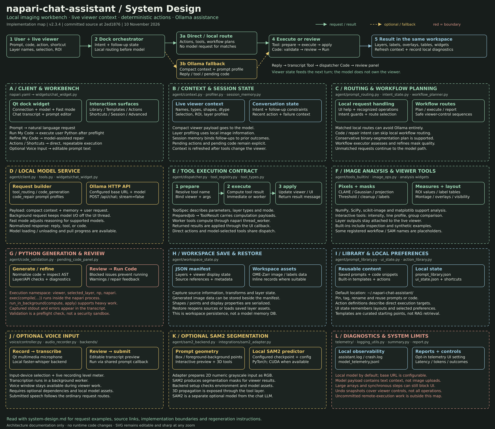
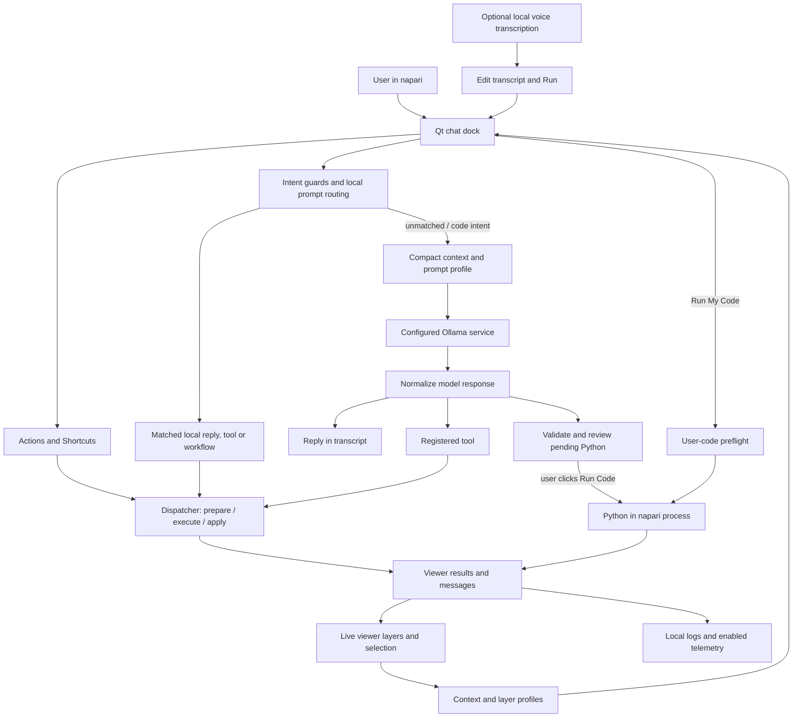

# napari-chat-assistant system design

[Zoomable SVG](system-design.svg) · [High-resolution PNG](system-design.png) · [Printable PDF](system-design.pdf)



This map follows the panel layout of the supplied Google Maps system-design reference, using the actual napari plugin components. It documents version 2.3.4 at commit `2ed1876`, inspected on 10 November 2026. It describes the implemented workbench rather than a proposed distributed service.

## Main request paths



The flowchart simplifies several early-return routes: local help and reports can return text directly; workflow routes may plan, execute or report without calling Ollama. Direct action definitions can target tools, code or UI handlers.

## A–L: source map

| Panel | Responsibility | Main source |
| --- | --- | --- |
| A | Plugin registration, dock controls, chat, Library, Actions, Shortcuts and Session | [napari.yaml](../src/napari_chat_assistant/napari.yaml), [chat_widget.py](../src/napari_chat_assistant/widgets/chat_widget.py), [chat_sections](../src/napari_chat_assistant/widgets/chat_sections/) |
| B | Viewer summaries, semantic profiles, session memory, recent actions and follow-ups | [context.py](../src/napari_chat_assistant/agent/context.py), [profiler.py](../src/napari_chat_assistant/agent/profiler.py), [session_memory.py](../src/napari_chat_assistant/agent/session_memory.py), [followup_semantics.py](../src/napari_chat_assistant/agent/followup_semantics.py) |
| C | Intent constraints, recognized local routes, workflow plans and execution | [intent_state.py](../src/napari_chat_assistant/agent/intent_state.py), [prompt_routing.py](../src/napari_chat_assistant/agent/prompt_routing.py), [workflow_planner.py](../src/napari_chat_assistant/agent/workflow_planner.py), [workflow_executor.py](../src/napari_chat_assistant/agent/workflow_executor.py) |
| D | Model lifecycle, HTTP requests, prompt profiles and model response handling | [client.py](../src/napari_chat_assistant/agent/client.py), [tools.py](../src/napari_chat_assistant/agent/tools.py), [chat_widget.py](../src/napari_chat_assistant/widgets/chat_widget.py) |
| E | Tool discovery, parameters, execution modes and result application | [dispatcher.py](../src/napari_chat_assistant/agent/dispatcher.py), [tool_registry.py](../src/napari_chat_assistant/agent/tool_registry.py), [tool_types.py](../src/napari_chat_assistant/agent/tool_types.py) |
| F | Image operations, masks, ROI measurements, presentation and interactive analysis | [tools_builtin](../src/napari_chat_assistant/agent/tools_builtin/), [image_ops.py](../src/napari_chat_assistant/agent/image_ops.py), [widgets](../src/napari_chat_assistant/widgets/), [tool inventory](developer_tool_inventory.md) |
| G | Code normalization, AST/API checks, pending-code review and execution | [code_validation.py](../src/napari_chat_assistant/agent/code_validation.py), [pending_code_panel.py](../src/napari_chat_assistant/widgets/chat_sections/pending_code_panel.py), [chat_widget.py](../src/napari_chat_assistant/widgets/chat_widget.py) |
| H | Workspace manifest, source references, layer assets and restoration | [workspace_state.py](../src/napari_chat_assistant/agent/workspace_state.py) |
| I | Saved prompts/code, built-in templates/action definitions and remembered UI state | [prompt_library.py](../src/napari_chat_assistant/agent/prompt_library.py), [action_library.py](../src/napari_chat_assistant/agent/action_library.py), [template_catalog.py](../src/napari_chat_assistant/library/template_catalog.py), [ui_state.py](../src/napari_chat_assistant/agent/ui_state.py) |
| J | Microphone capture, local transcription, preview and prompt submission | [voice](../src/napari_chat_assistant/voice/) |
| K | SAM2 environment setup, prompting, predictor adaptation and segmentation | [sam2_backend.py](../src/napari_chat_assistant/agent/sam2_backend.py), [sam2_adapter.py](../src/napari_chat_assistant/integrations/sam2_adapter.py) |
| L | Local diagnostic files, activity/model events, summaries and reports | [telemetry](../src/napari_chat_assistant/telemetry/), [logging_utils.py](../src/napari_chat_assistant/telemetry/logging_utils.py) |

## Example journeys

**Direct image action.** Select an image and run a Gaussian-denoise Action. Its definition resolves to a registered tool. `prepare_tool_job` binds viewer context and arguments. A worker-mode job computes without applying viewer changes inside that computation; its returned result is applied through `apply_tool_job_result`. The dock refreshes context and displays the result. Immediate tools complete during preparation through the same registered tool contract.

**Natural-language analysis request.** The dock resolves intent, follow-up constraints and applicable local routes. A recognized request may execute locally. Otherwise, the model request carries compact viewer context, session memory, failure/repair context and the user message. `client.chat_ollama` posts to `/api/chat` with `stream=False`; the reply is normalized into a text reply, tool selection or code proposal. This is an application-controlled route, rather than unrestricted model access to napari.

**Custom code.** A code-generation or repair request uses its corresponding prompt profile. Generated Python is normalized and checked, then placed in the pending-code panel. Blocking issues disable execution. After review, Run Code performs preflight and executes against the existing `viewer`, with `selected_layer`, NumPy and napari available. Run My Code goes directly through the user-code preflight path. `run_in_background(compute, apply)` is available for explicit background jobs. Exceptions and captured stdout feed back into the workbench.

**Voice and SAM2.** Voice records locally, transcribes using optional faster-whisper, then submits reviewed text through the shared prompt callback. SAM2 uses a separate optional segmentation backend, configured model files and local PyTorch; it is not the chat model. Box/point prompts feed segmentation tools and return masks to the viewer.

**Save and restore.** Workspace capture records layers and viewer display state. A JSON manifest can refer to original sources, inline records and saved OME-Zarr assets. Generated image and labels data can be saved alongside the manifest. Restoration reconstructs the recorded workspace from those sources and assets; it does not restore every live Python object or worker.

## Data and process boundaries

| Boundary | Actual behavior |
| --- | --- |
| napari process | Qt UI, live layers, orchestration, built-in tools and Python execution share the application process. Worker threads are not separate security processes. |
| Ollama service | HTTP endpoint defaults to local use but is configurable. The chat request contains text, compact context and metadata, not an image-upload field. A remote base URL sends that text context to the configured server. |
| Model response | Tool names and arguments return to the application dispatcher. Python proposals pass through review and validation before execution. |
| Python execution | `exec(compile(...))` uses normal Python builtins. Validation checks compatibility and common mistakes; it is not an isolation or security sandbox. |
| Local preferences/library | `~/.napari-chat-assistant/ui_state.json` and `prompt_library.json` preserve UI preferences and reusable content. Workspace files are saved at the user-selected destination. |
| Local diagnostics | `assistant.log`, `crash.log` and enabled `model_telemetry.jsonl` events live under `~/.napari-chat-assistant/`. The UI telemetry preference defaults to off; ordinary application logs are separate. |
| Optional assets | Voice and SAM2 require their dependencies and model assets. Initial installation/model downloads can require internet access; configured local inference uses the downloaded assets. |

## Implementation limits

- `chat_widget.py` owns substantial orchestration and state. The component panels represent responsibilities, not independent deployed services.
- Registered worker tools and model/voice requests use background workers, but synchronous workflows, immediate operations and user Python can still occupy the UI thread. Large arrays can also incur memory and conversion costs.
- Workflow execution currently recognizes the conservative binary-segmentation workflow; registered placeholder names do not establish general autonomous workflow support. See the [tool inventory](developer_tool_inventory.md).
- Viewer-control snapshots support undo for quick-control sequences. They do not provide universal rollback for image edits, layer deletion or arbitrary Python.
- The Library is curated and locally persisted content. This architecture does not include a vector database, RAG service, cloud message bus or central analytics backend.
- The working tree contained uncommitted `execution/` code and related package exports/tests during inspection. It is excluded from the implemented architecture shown here; the committed dock dispatch path does not integrate that remote-execution work.

## Regenerating the poster

Run from the repository root:

```bash
python docs/generate_system_design.py
```

The script writes the SVG using only the standard library. With qtpy and a Qt binding installed, it also exports a 4800 × 4160 PNG and a single-page PDF using Qt's SVG renderer. Edit the panel text and layout in [generate_system_design.py](generate_system_design.py), then regenerate all three formats together. No plugin runtime files need to change.
